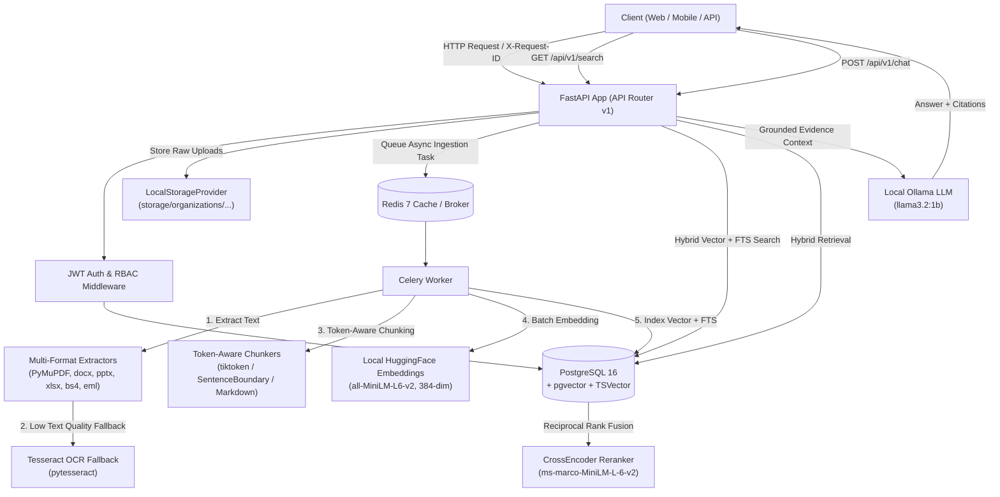

# Enterprise Document Intelligence Platform

A local-first, multi-tenant enterprise document intelligence platform featuring asynchronous document processing, OCR fallback, token-aware chunking, local vector search (`pgvector`), PostgreSQL full-text search, hybrid Reciprocal Rank Fusion (RRF), cross-encoder reranking, and local RAG chat with verifiable document citations.

---

## 🏗 System Architecture



---

## 🔥 Key Features

* **100% Free & Local Execution**: Runs entirely on your local machine without requiring paid API keys (No OpenAI, AWS, or cloud vendor lock-in).
* **Multi-Tenant Data Isolation**: Strict organization-level boundaries enforced at the database query level *before* any ranking or retrieval operations occur.
* **Role-Based Access Control (RBAC)**: Fine-grained permissions (`OWNER`, `ADMIN`, `EDITOR`, `VIEWER`).
* **Multi-Format Extraction Engine**: Extracts text from PDF, DOCX, PPTX, XLSX, HTML, EML, TXT, Markdown, PNG, JPG, JPEG, and ZIP archives.
* **Page-Level OCR Fallback**: Automatic detection of scanned or low-quality PDF pages, invoking Tesseract OCR for affected pages only.
* **Safe ZIP Extraction**: Zip Slip / path traversal protection, maximum file count, depth, and decompression size enforcement.
* **Token-Aware Chunking**: Configurable `tiktoken` sliding window, sentence-boundary, and markdown section chunking strategies.
* **Hybrid Semantic Retrieval**: PostgreSQL `pgvector` vector similarity search combined with `TSVector` GIN full-text search via **Reciprocal Rank Fusion (RRF)** ($k=60$) and optional CrossEncoder reranking (`ms-marco-MiniLM-L-6-v2`).
* **Grounded Local RAG Chat**: Local LLM integration via **Ollama** producing verifiable document source citations (`document_id`, `document_name`, `version`, `page`, `chunk_id`) with built-in prompt injection defense.
* **API Key Management**: SHA-256 hashed API keys (`edip_live_...`) with expiration dates, revocation, and scope control.
* **Audit Logging & Observability**: Append-only audit trail logging system events without exposing credentials, coupled with `X-Request-ID` tracing, structured JSON logging, and `/health/ready` readiness checks.

---

## 🛠 Technology Stack

* **Backend Framework**: Python 3.12, FastAPI, Pydantic v2, Uvicorn
* **Database & Vector Store**: PostgreSQL 16, `pgvector`, SQLAlchemy 2.0 Async, Alembic
* **Background Tasks & Queue**: Celery 5.3, Redis 7
* **Authentication**: JWT Access & Refresh Tokens, Argon2 Password Hashing
* **Document Processing & OCR**: PyMuPDF (`fitz`), `python-docx`, `python-pptx`, `openpyxl`, `BeautifulSoup4`, `pytesseract`, Tesseract OCR
* **Embeddings & Search**: `sentence-transformers/all-MiniLM-L6-v2` (384-dim), `cross-encoder/ms-marco-MiniLM-L-6-v2`, PostgreSQL Full-Text Search
* **Local LLM**: Ollama (`llama3.2:1b`)
* **Testing & Quality**: Pytest, Pytest-Asyncio, HTTPX

---

## 📁 Directory Structure

```
.
├── app/
│   ├── api/v1/             # FastAPI Endpoint Handlers (auth, orgs, projects, docs, search, chat, api_keys, health)
│   ├── core/               # Configuration, security, logging, exceptions, dependencies
│   ├── db/                 # Async database session & base declarative models
│   ├── middleware/         # RequestContextMiddleware for X-Request-ID correlation
│   ├── models/             # SQLAlchemy database models (User, Org, Project, Document, Chunk, Job, APIKey, AuditLog)
│   ├── processing/         # Extraction engine, extractors, OCR fallback, language detection, text normalization
│   ├── providers/          # Embeddings (HuggingFace), LLM (Ollama), Rerank (CrossEncoder), Storage (Local)
│   ├── repositories/       # Multi-tenant isolated database repositories
│   ├── schemas/            # Pydantic request and response schemas
│   ├── services/           # Domain business logic services
│   └── workers/            # Celery application & asynchronous background tasks
├── alembic/                # Database migration scripts & env configuration
├── tests/                  # Pytest test suite (auth, orgs, tenant isolation, chunking, search)
├── Dockerfile              # Docker container image with Python 3.12 & Tesseract OCR
├── docker-compose.yml      # Multi-container orchestra (API, Postgres pgvector, Redis, Celery Worker)
├── requirements.txt        # Python package dependencies
└── .env.example            # Environment settings template
```

---

## 🚀 Quick Start (Local Docker Compose)

### 1. Prerequisites
Ensure you have the following installed locally:
* [Docker Desktop](https://www.docker.com/) (with Docker Compose)
* [Ollama](https://ollama.ai/) (Optional for RAG Chat)

### 2. Configure Environment Variables
Copy `.env.example` to `.env`:
```bash
cp .env.example .env
```

### 3. Launch Platform Containers
Run Docker Compose:
```bash
docker compose up --build -d
```

This starts four isolated services:
1. `edip_postgres`: PostgreSQL 16 database with `pgvector` extension (Port `5432`).
2. `edip_redis`: Redis 7 broker & cache (Port `6379`).
3. `edip_api`: FastAPI application server (Port `8000`).
4. `edip_celery_worker`: Celery worker processing document ingestion pipelines.

### 4. Run Database Migrations
Apply database migrations using Alembic inside the API container:
```bash
docker compose exec api alembic upgrade head
```

---

## 🤖 Setting Up Local Ollama for RAG Chat (Optional)

1. Install Ollama from [ollama.ai](https://ollama.ai).
2. Download a lightweight local model:
   ```bash
   ollama pull llama3.2:1b
   ```
3. Start the Ollama local daemon:
   ```bash
   ollama serve
   ```
> *Note: Document upload, OCR extraction, text chunking, vector indexing, and hybrid search work 100% independently without requiring Ollama.*

---

## 💡 Example End-to-End API Workflow

### 1. Register User & Login
```bash
# Register
curl -X POST "http://localhost:8000/api/v1/auth/register" \
     -H "Content-Type: application/json" \
     -d '{"email": "alice@acme.com", "password": "Password123!", "full_name": "Alice Admin"}'

# Login
curl -X POST "http://localhost:8000/api/v1/auth/login" \
     -H "Content-Type: application/json" \
     -d '{"email": "alice@acme.com", "password": "Password123!"}'
# Output: {"access_token": "ey...", "refresh_token": "ey..."}
```

### 2. Create Organization & Project
```bash
# Create Organization
curl -X POST "http://localhost:8000/api/v1/organizations" \
     -H "Authorization: Bearer <ACCESS_TOKEN>" \
     -H "Content-Type: application/json" \
     -d '{"name": "Acme Corporation"}'
# Output: {"id": "ORG_UUID", "slug": "acme-corporation", ...}

# Create Project
curl -X POST "http://localhost:8000/api/v1/organizations/<ORG_UUID>/projects" \
     -H "Authorization: Bearer <ACCESS_TOKEN>" \
     -H "Content-Type: application/json" \
     -d '{"name": "HR Policies"}'
# Output: {"id": "PROJECT_UUID", "name": "HR Policies", ...}
```

### 3. Upload Document
```bash
curl -X POST "http://localhost:8000/api/v1/documents/upload" \
     -H "Authorization: Bearer <ACCESS_TOKEN>" \
     -F "organization_id=<ORG_UUID>" \
     -F "project_id=<PROJECT_UUID>" \
     -F "file=@employee_handbook.pdf"
```

### 4. Check Ingestion Status
```bash
curl -X GET "http://localhost:8000/api/v1/documents/<DOC_UUID>/status?organization_id=<ORG_UUID>" \
     -H "Authorization: Bearer <ACCESS_TOKEN>"
```

### 5. Perform Hybrid Search
```bash
curl -X GET "http://localhost:8000/api/v1/search?organization_id=<ORG_UUID>&project_id=<PROJECT_UUID>&query=annual+leave+policy" \
     -H "Authorization: Bearer <ACCESS_TOKEN>"
```

### 6. RAG Chat Question & Answer
```bash
curl -X POST "http://localhost:8000/api/v1/chat" \
     -H "Authorization: Bearer <ACCESS_TOKEN>" \
     -H "Content-Type: application/json" \
     -d '{
       "organization_id": "<ORG_UUID>",
       "project_id": "<PROJECT_UUID>",
       "question": "How many days of paid leave do employees get?"
     }'
```

---

## 🧪 Testing Instructions

Run the unit and integration test suite (including cross-tenant security verification):
```bash
pytest -v
```

---

## 🔒 Security & Multi-Tenancy Design

* **Zero Cross-Tenant Leakage**: Every repository query forces an explicit `organization_id` filter prior to performing vector similarity or full-text scoring.
* **Role Hierarchy & RBAC**: Operations are restricted based on user role (`OWNER` > `ADMIN` > `EDITOR` > `VIEWER`).
* **Secure API Keys**: Keys use a readable prefix (`edip_live_...`) with secret values hashed using SHA-256 (`hash_api_key`), ensuring plain keys are shown only once upon creation.
* **Prompt Injection Defense**: RAG system prompts explicitly mandate that retrieved chunks are untrusted evidence, forbidding execution of embedded prompt override instructions.
