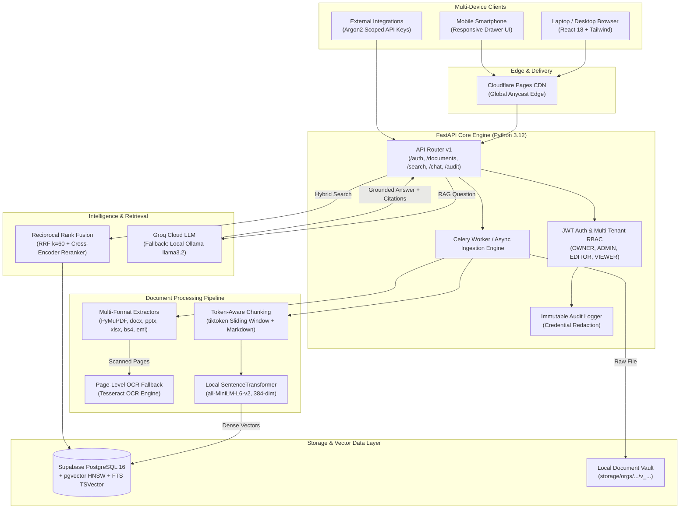

# 🏢 Enterprise Document Intelligence Platform

> **A Production-Grade, Local-First & 24/7 Cloud Hybrid Document Intelligence Engine with Grounded RAG, pgvector Hybrid Retrieval, and Multi-Tenant Isolation.**

[](https://enterprise-document-intelligence.pages.dev)
[](https://supabase.com)
[](https://console.groq.com)
[](LICENSE)

---

## 🌐 Live Deployments & Endpoints

| Service / Interface | Live URL | Description | Ongoing Cost |
| :--- | :--- | :--- | :---: |
| **Production Web UI** | [https://enterprise-document-intelligence.pages.dev](https://enterprise-document-intelligence.pages.dev) | Responsive (Mobile & Laptop) Executive Dashboard | **₹0 Forever** |
| **Direct Authentication** | [https://enterprise-document-intelligence.pages.dev/login](https://enterprise-document-intelligence.pages.dev/login) | Argon2id + JWT Secure Login & Registration | **₹0 Forever** |
| **Deployment Alias** | [https://84557472.enterprise-document-intelligence.pages.dev](https://84557472.enterprise-document-intelligence.pages.dev) | Immutable Production Build Alias | **Included** |
| **Vector DB (Supabase)** | [Database Dashboard](https://supabase.com/dashboard/project/aeseryhjqjcsxprrmoib) | PostgreSQL 16 + native `pgvector` in `ap-south-1` Mumbai | **₹0 Forever** |
| **Fast LLM Inference** | [Groq Cloud Console](https://console.groq.com/home) | Sub-500ms RAG answer synthesis (`openai/gpt-oss-20b`) | **₹0 Free Tier** |
| **Local Backend API** | `http://127.0.0.1:8000/docs` | Interactive OpenAPI 3.1 Swagger & ReDoc UI | **Local** |

---

## 🏗 System Architecture



---

## 🔥 Key Enterprise Features

* **📱 Multi-Device Adaptive Interface**: Fully responsive on both laptop screens and mobile phones with off-canvas sliding navigation, touch controls, and compact prompt chips.
* **🛡️ Zero-Trust Multi-Tenant Isolation**: Hard query-level organization isolation across all database operations, documents, chunks, and search vectors. Cross-tenant access attempts return HTTP 403.
* **🔍 Hybrid Semantic Search**:
  * **Dense Vector Search**: 384-dimensional cosine similarity via `pgvector` HNSW indexes.
  * **Lexical Keyword Search**: PostgreSQL Full-Text Search with `english` dictionary stemming and GIN indexing.
  * **Reciprocal Rank Fusion (RRF)**: Merges sparse and dense scores ($k=60$) followed by Cross-Encoder neural reranking (`ms-marco-MiniLM-L-6-v2`).
* **🤖 Grounded RAG AI Assistant**:
  * Groq Cloud ultra-fast inference with local Ollama fallback.
  * Verifiable source citations down to document filename, page number, and chunk ID.
  * Prompt injection defense and strict contextual boundaries.
* **📑 Multi-Format Parsing & OCR**:
  * Extracts PDF, DOCX, PPTX, XLSX, HTML, EML, TXT, Markdown, PNG, JPG, and ZIP archives.
  * Page-level Tesseract OCR fallback for scanned documents and low-text density pages.
  * Zip Slip security mitigation against directory traversal attacks.
* **🔐 Scoped API Keys & Audit Trail**:
  * Argon2id / SHA-256 hashed keys (`edip_live_...`) with scope restrictions (`read:documents`, `write:documents`, `search`, `chat`).
  * Immutable audit log trail capturing all organizational actions with automatic credential redaction.
* **💸 100% Free Forever Architecture**: Runs indefinitely on Supabase Free Tier, Groq Cloud Free Tier, and Cloudflare Pages Free Tier with zero credit card requirements.

---

## 🛠 Tech Stack

* **Frontend**: React 18, TypeScript, Tailwind CSS, TanStack React Query, Lucide Icons, Vite
* **Backend API**: Python 3.12, FastAPI, Pydantic v2, SQLAlchemy 2.0 Async, Alembic
* **Vector DB**: Supabase PostgreSQL 16, `pgvector`, HNSW indexes, PgBouncer pooler
* **Document Extraction**: PyMuPDF (`pymupdf`), `python-docx`, `python-pptx`, `openpyxl`, `beautifulsoup4`, `pytesseract`
* **Embeddings & Reranking**: `sentence-transformers/all-MiniLM-L6-v2`, `cross-encoder/ms-marco-MiniLM-L-6-v2`
* **LLM Providers**: Groq Cloud API (`openai/gpt-oss-20b`), Ollama (`llama3.2:1b`)
* **Background Tasks**: Celery 5.3, Redis 7 (with standalone async task fallback)
* **Hosting**: Cloudflare Pages (Edge CDN, SSL/TLS, SPA routing)

---

## 🚀 Getting Started Locally

### 1. Clone the Repository
```bash
git clone https://github.com/rithvikkaki/Enterprise-Document-Intelligence-Assistant.git
cd Enterprise-Document-Intelligence-Assistant
```

### 2. Environment Configuration
Create a `.env` file in the root directory:
```env
# Database (Supabase PostgreSQL / PgBouncer pooler or local PostgreSQL)
DATABASE_URL=postgresql+asyncpg://postgres.<REF>:<PASSWORD>@aws-0-ap-south-1.pooler.supabase.com:6543/postgres?ssl=require

# Cloud AI (Groq Cloud) or Local LLM (Ollama)
GROQ_API_KEY=your_groq_api_key_here
OLLAMA_BASE_URL=http://localhost:11434
OLLAMA_MODEL=llama3.2:1b

# Security
SECRET_KEY=generate_a_secure_random_hex_string_here
ALGORITHM=HS256
ACCESS_TOKEN_EXPIRE_MINUTES=60
REFRESH_TOKEN_EXPIRE_DAYS=7

# Redis / Celery (Optional - falls back to async background tasks)
REDIS_URL=redis://localhost:6379/0
```

### 3. Install Backend Dependencies & Run Migrations
```bash
python -m venv venv
venv\Scripts\activate      # On Windows
source venv/bin/activate   # On Linux/macOS

pip install -r requirements.txt
alembic upgrade head
```

### 4. Start the FastAPI Server
```bash
uvicorn app.main:app --host 127.0.0.1 --port 8000 --reload
```
Swagger UI will be accessible at: `http://127.0.0.1:8000/docs`

### 5. Start Frontend Development Server
```bash
cd frontend
npm install
npm run dev
```
Open `http://localhost:5173` in your browser.

---

## 🧪 Testing & Verification

Run the full automated test suite:
```bash
# Unit & integration tests (Auth, Ingestion, Isolation, RAG)
pytest

# Live end-to-end stress test across all 10 pipeline stages
python tests/verify_live_e2e_random.py
```

---

## 📄 License
This project is licensed under the strict copyleft **GNU Affero General Public License v3.0 (AGPL-3.0)**. See the [LICENSE](LICENSE) file for complete details.
